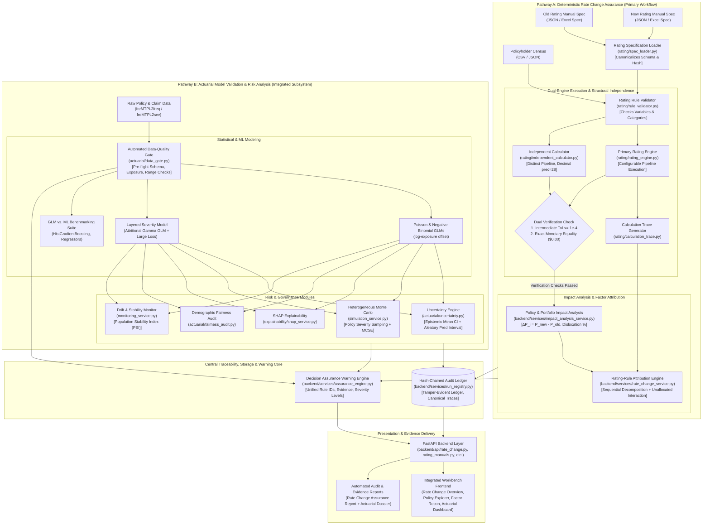
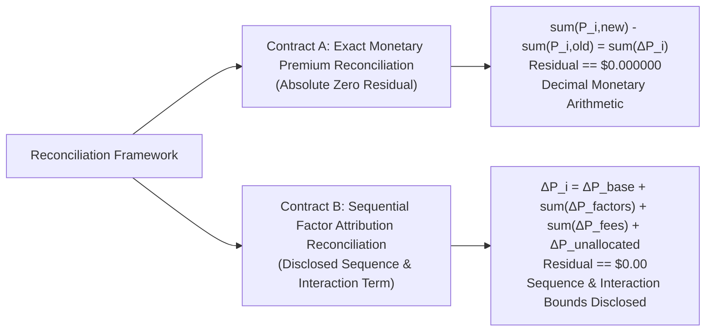
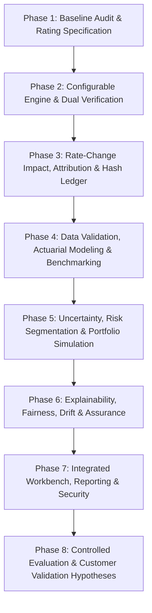

# Rate Change Assurance Workbench: An Integrated Actuarial Model Validation, Pricing Reconciliation, and Decision Assurance System

## Final Implementation Plan (Version 5.0 — Authoritative Engineering & Actuarial Specification)

---

## 1. Executive Summary

The system is developed as an integrated actuarial decision-support platform combining two connected capabilities:

1. **Rate Change Assurance (Primary Product Workflow):** Import old and new insurance rating manuals and a policy census, calculate premiums under both rating specifications, identify policy-level and portfolio-level changes, verify calculations independently, attribute premium differences to rating-rule changes, and generate reproducible review evidence.
2. **Actuarial Model Validation and Decision Assurance (Integrated Subsystem):** Retain frequency and severity modeling, GLM/ML benchmarking, uncertainty quantification, portfolio simulation, explainability, fairness diagnostics, drift monitoring, automated data validation, model-run reconciliation, assurance warnings, and actuarial reporting.

The Rate Change Assurance workflow serves as the primary product workflow. Existing actuarial modeling and governance capabilities remain integrated modules rather than being removed.

### Strict Separation of Calculation Pathways
The system strictly enforces separate calculation pathways for deterministic rating-manual calculations and statistical model-based risk estimates. These outputs must never be treated as interchangeable:
* **Deterministic Rating-Manual Pathway:** Evaluates formal rate-filing rules, discrete rating factor tables, additive policy fees, statutory clamping, and regulatory rounding conventions to produce **premiums calculated according to the supplied rating specification**.
  > [!WARNING]
  > Calculating premiums according to an imported rating specification does not, by itself, establish that the specification is legally authorized, current, or compliant in a given jurisdiction. The engine includes explicit manual effective-date checks, regulatory filing approval metadata, and automated warnings when jurisdictional authorization has not been independently verified.
* **Statistical Risk-Estimation Pathway:** Evaluates Generalized Linear Models (Poisson, Negative Binomial, Gamma) and machine learning regressors to produce expected claim frequencies, severities, pure premiums, parameter confidence intervals, and stochastic portfolio loss distributions.

### Implementation Principles
* **Configurable Rating Specifications:** Calculation sequences, rounding conventions, and currency precisions are part of the versioned rating manual specification. The engine supports an explicitly documented subset of rules; unsupported or ambiguous rules (including underspecified tax bases or clamping stages) are rejected explicitly rather than silently approximated.
* **True Structural Independence:** The secondary verification calculator implements an entirely distinct parsing, lookup, and calculation pipeline utilizing Python `decimal.Decimal` with configured context precision (`getcontext().prec = 28`), tested against hand-calculated ground-truth benchmarks and independently generated reference cases.
* **Exact Monetary Equality:** Final currency comparison requires **exact numerical equality after applying specified currency quantization** ($\Delta P = \$0.00$), distinct from intermediate continuous calculation tolerances.
* **Dual Reconciliation Contracts:** Clear mathematical separation between exact monetary premium reconciliation ($\Delta P = \$0.00$) and path-dependent sequential factor attribution with explicit reporting of unallocated interaction adjustments.
* **Tamper-Evident Hash-Chained Audit Ledger:** Append-only local storage with cryptographic linear hash chaining, canonical RFC 8785 JSON serialization, protected key storage, and external checkpoint anchoring.
* **Single-User Local Deployment Target:** The initial operational target is single-user local workstation execution on synthetic data. Multi-tenant cloud security is documented as a future enterprise phase requiring distinct architectural controls.

---

## 2. Integrated System Architecture

The architecture unifies the primary **Rate Change Assurance** engine with the comprehensive **Actuarial Model Validation & Governance** subsystem. Both pathways feed into shared traceability, run registry, and reporting services while strictly maintaining independent calculation contracts and validation criteria.



### 2.1 Distinct Verification and Governance Status Indicators
To avoid conflating distinct types of validation into a generic "verified" badge, the workbench presents three separate, independently reported status indicators for every rating run:
1. **Census Validation Status:** Indicates whether all census records comply with the manual's declared schema, allowed variable domains, and explicit eligibility criteria (e.g. `PASS: 100% Valid Census` or `FAIL: 3 Ineligible, 1 Missing Attribute`).
2. **Independent Calculation Agreement:** Verifies mathematical and algorithmic fidelity by comparing the primary engine against the independent `Decimal` calculator. Reports both intermediate agreement ($\epsilon_{\text{inter}} \le 10^{-4}$) and final monetary equality ($\Delta P_{\text{currency}} = \$0.00$).
3. **Source-Manual Authorization Status:** Tracks regulatory governance metadata, explicitly verifying jurisdictional alignment, effective-date validity, and filing authority references (e.g. SERFF tracking number) to alert the user if a calculation uses an unauthorized, expired, or draft specification.

---

## 3. Dedicated Rating-Manual Module Architecture (`rating/`)

The core deterministic rating engine is implemented as a dedicated package `rating/`:

```text
rating/
├── spec_schema.py             # Pydantic v2 schemas defining rating manual specs
├── spec_loader.py             # Imports JSON/Excel/CSV tables and canonicalizes SHA-256
├── rule_validator.py          # Validates policy records & detects conflicting/missing rules
├── rating_engine.py           # Primary configurable pipeline rating calculation engine
├── calculation_trace.py       # Step-by-step audit trace recorder with unrounded values
├── rounding_policy.py         # ISO 4217 minor-unit precision, rounding stages, and conventions
└── independent_calculator.py  # Structurally independent Decimal verification engine
```

### 3.1 Configurable Calculation Pipeline & Mathematical Rule Definitions
The rating manual specification defines an ordered `calculation_pipeline`. The engine iterates strictly through the specified pipeline steps.

```json
{
  "manual_id": "AUTO-2026-REVISION",
  "version": "2.0.0",
  "effective_date_start": "2026-01-01",
  "effective_date_end": "2026-12-31",
  "jurisdiction": "US-OH",
  "filing_reference": "SERFF-OH-2025-10928",
  "currency": "USD",
  "calculation_pipeline": [
    {"step_type": "BASE_RATE"},
    {"step_type": "MULTIPLICATIVE_FACTOR", "variable": "territory"},
    {"step_type": "MULTIPLICATIVE_FACTOR", "variable": "driver_age_band"},
    {"step_type": "DISCOUNT_CREDIT", "variable": "paperless_discount", "is_taxable_deduction": true},
    {"step_type": "INTERMEDIATE_ROUNDING", "rule": "ROUND_HALF_UP", "precision": 4},
    {"step_type": "ADDITIVE_FEE", "fee_name": "policy_fee", "is_taxable": false},
    {"step_type": "STATUTORY_CLAMPING", "min_premium": 250.00, "max_premium": 5000.00, "clamp_stage": "PRE_TAX"},
    {"step_type": "STATUTORY_TAX", "tax_rate": 0.05, "tax_base": "TAXABLE_BASE"},
    {"step_type": "FINAL_ROUNDING", "rule": "ROUND_HALF_UP", "precision_source": "ISO_4217"}
  ]
}
```

#### Step-by-Step Pipeline State Transitions and Subtotal Invariants
Every pipeline step takes a strictly defined prior subtotal $P_{s-1}$ and produces an updated subtotal $P_s$, tracking taxable and non-taxable accumulators:

| Step $s$ | Step Type | Inputs | Mathematical Subtotal Transformation | Output State $P_s$ |
|---|---|---|---|---|
| **0** | **Initialization** | Policy census record | $P_0 = 0.00$, $\text{TaxableBase}_0 = 0.00$, $\text{NonTaxableFees}_0 = 0.00$ | Initialized zero accumulators |
| **1** | `BASE_RATE` | Spec base rate $B > 0$ | $P_1 = B$; $\text{TaxableBase}_1 = B$ | Baseline unadjusted premium |
| **2..k** | `MULTIPLICATIVE_FACTOR` | Census variable $v$, factor table $f_v$ | $P_s = P_{s-1} \times f_v(x)$; $\text{TaxableBase}_s = P_s$ | Risk-adjusted factor product subtotal |
| **k+1** | `DISCOUNT_CREDIT` | Discount rate $d$ or flat amount $D$, flag `is_taxable_deduction` | $P_s = \max(0.00, P_{s-1} \times (1 - d) - D)$; if deductible, $\text{TaxableBase}_s = P_s$ | Discounted loaded subtotal (bounded at $0.00$) |
| **k+2** | `INTERMEDIATE_ROUNDING` | Precision $p$, Mode $R$ | $P_s = \text{Quantize}(P_{s-1}, p, R)$; $\text{TaxableBase}_s = P_s$ | Truncated/rounded intermediate subtotal |
| **k+3** | `ADDITIVE_FEE` | Fee amount $F$, flag `is_taxable` | $P_s = P_{s-1} + F$; if `is_taxable`: $\text{TaxableBase}_s = \text{TaxableBase}_{s-1} + F$, else: $\text{NonTaxableFees}_s = \text{NonTaxableFees}_{s-1} + F$ | Subtotal with additive policy fees |
| **k+4** | `STATUTORY_CLAMPING` (`clamp_stage="PRE_TAX"`) | Minimum $\min$, Maximum $\max$ | $P_s = \min(\max(P_{s-1}, \min), \max)$; $\text{TaxableBase}_s = \min(\max(\text{TaxableBase}_{s-1}, \min), \max)$ | Pre-tax statutory clamped subtotal |
| **k+5** | `STATUTORY_TAX` | Tax rate $\tau$, target `tax_base` | If `TAXABLE_BASE`: $T = \text{Quantize}(\text{TaxableBase}_{s-1} \times \tau)$; if `GROSS_PREMIUM`: $T = \text{Quantize}(P_{s-1} \times \tau)$. $P_s = P_{s-1} + T$ | Tax-inclusive gross commercial subtotal |
| **k+6** | `STATUTORY_CLAMPING` (`clamp_stage="POST_TAX"`) | Minimum $\min$, Maximum $\max$ | $P_s = \min(\max(P_{s-1}, \min), \max)$ | Post-tax clamped gross invoice amount |
| **k+7** | `FINAL_ROUNDING` | ISO 4217 minor-unit precision $p_{\text{ISO}}$, Mode $R$ | $P_{\text{final}} = \text{Quantize}(P_{s-1}, p_{\text{ISO}}, R)$ | Commercial payable premium (exact monetary quantity) |

#### Mathematical Definitions of Charges, Taxes, and Statutory Limits
1. **Base Rate:** Initial positive baseline premium anchor ($B > 0$).
2. **Multiplicative Factors:** Categorical or discrete band multipliers ($f > 0$).
3. **Discounts & Credits:** Multiplicative factors $< 1.00$ or negative additive adjustments ($-\$D$). Non-negative subtotal bounds are enforced:
   $$\text{Premium}_{\text{subtotal}} = \max\left(0.00, \; B \times \prod f_k - D\right)$$
4. **Additive Fees & Surcharges:** Fixed charges ($F \ge 0$). Zero-rated fees ($F = 0.00$) are explicitly supported. Each fee explicitly declares an `is_taxable: bool` flag.
5. **Exact Mathematical Definition of Taxable Base:**
   When `tax_base` is `"TAXABLE_BASE"`, the taxable base is computed as:
   $$\text{TaxableBase} = \text{PureOrLoadedPremium} + \sum_{j \in \text{TaxableFees}} \text{Fee}_j - \sum_{k \in \text{TaxableDiscounts}} \text{Discount}_k$$
   Non-taxable statutory charges (e.g., state guaranty fund assessments, certain flat policy fees with `is_taxable: false`) are strictly excluded from the tax base. When `tax_base` is `"GROSS_PREMIUM"`, tax is calculated across the total premium including all fees.
   $$\text{TaxAmount} = \text{Quantize}\left(\text{TaxableBase} \times \text{TaxRate}, \; \text{currency\_precision}\right)$$
6. **Statutory Clamping Order (`clamp_stage`):**
   The specification must explicitly declare `clamp_stage`:
   * `"PRE_TAX"`: Clamping applies to the premium before taxes are assessed ($\min \le P_{\text{pre-tax}} \le \max$, then taxes are added).
   * `"POST_TAX"` / `"GROSS_FINAL"`: Clamping applies to the final gross commercial premium including taxes.
   > [!CAUTION]
   > Any specification that declares taxes or limits without unambiguously defining `tax_base` or `clamp_stage` is rejected by `rule_validator.py` with an `AmbiguousTaxSpecificationError`. The engine **never** assumes a default tax base or clamping order.
7. **Eligibility Rules & Ineligibility Handling:** Documented categorical sets and numeric boundaries. Policies violating eligibility receive an explicit status `INELIGIBLE` with a structured list of rejection reason codes.

### 3.2 Production Edge-Case & Data-Handling Specifications
* **Missing Feature Values:** A fatal validation failure (`MissingRatingVariableError`) is raised immediately. The engine **never** silently imputes, guesses, or defaults missing policy variables.
* **Newly Added Rating Factors:** If the new manual introduces a rating factor not present in the old manual (e.g., `telematics_score`):
  - The policy census must supply the variable; otherwise, validation fails.
  - In factor attribution, the baseline model evaluates the old factor as $1.00$ (neutral relativity), and attributes the difference to the newly introduced factor.
* **Removed Rating Factors:** If a factor from the old manual is retired in the new manual, the new calculation evaluates the factor as $1.00$, and attribution captures the elimination of the factor.
* **Asymmetric Eligibility (Displaced & Inception Policies):**
  - **Eligible Old $\to$ Ineligible New:** If a policyholder is eligible under the old manual but rejected by the new manual's underwriting rules, the policy is classified as **"Ineligible Under Revision / Displaced"**. It cannot have a standard numeric premium delta $\Delta P_i$; it is segregated into a dedicated "Displaced Policies" dislocation schedule.
  - **Ineligible Old $\to$ Eligible New:** If a policy was previously ineligible but becomes eligible under the new manual, it is classified as a **"New Inception"**. Percentage change is undefined; it is reported in a separate "New Market Expansion" schedule.
  - **Ineligible Under Both:** Excluded from premium reconciliation and counted in the rejected census summary.

---

## 4. Structural Independence & Correctness Verification Contract

### 4.1 Structural Independence Criteria
Running an independent calculator in Python `decimal.Decimal` prevents binary floating-point representation drift. However, **it does not prove mathematical or actuarial correctness on its own**: if both implementations share the same flawed interpretation of a manual rule, both will produce identical incorrect premiums.

To achieve genuine structural independence:
1. **Independent Implementation Architectures:**
   * **Primary Engine (`rating_engine.py`):** Utilizes a dynamic pipeline dispatch pattern, vector-compatible numeric execution, and runtime trace logging.
   * **Secondary Verifier (`independent_calculator.py`):** Implements an entirely independent parsing and evaluation routine using Python's `decimal.Decimal` with configured context precision (`getcontext().prec = 28`), separate table extraction logic, and an independent accumulator.
2. **Hand-Calculated Ground Truth Benchmarks:** Both engines are evaluated against 5 hand-calculated benchmark policies with complete step-by-step arithmetic proofs documented to the exact cent.
3. **Boundary and Stress Testing:**
   * **Rounding Boundaries:** Systematic evaluation of values ending exactly on the rounding boundary (e.g., `.005000` under `ROUND_HALF_UP` vs. `ROUND_HALF_EVEN`).
   * **Negative Credit Clamping:** Validating that stacked discounts cannot drive subtotal premiums negative before fees.
   * **Sequence Inversion:** Verifying calculation divergence when the manual specifies fees before factors vs. factors before fees.
4. **Dual Verification Tolerances:**
   * **Intermediate Calculation Tolerance ($\epsilon_{\text{inter}} \le 10^{-4}$):** Unrounded intermediate values between the primary float accumulator and the 28-digit Decimal verifier must agree within $10^{-4}$. This tolerance specifically accounts for minor mantissa discrepancies between IEEE 754 binary floating-point arithmetic (53-bit significand) and high-precision decimal representation prior to final quantization.
   * **Final Currency Tolerance (Exact Monetary Equality):** Final commercial premiums must match **with exact monetary equality after applying specified currency quantization** ($\Delta P_{\text{currency}} = \$0.00$). Any difference of even 1 minor currency unit (e.g. $\$0.01$) constitutes a hard verification failure.
   * **Replay Reproducibility Tolerance ($\epsilon_{\text{replay}} \le 10^{-6}$):** When an identical rating run is replayed from its recorded specification and inputs, the replay reproducibility tolerance is tightened to $10^{-6}$. Because the identical rating engine codebase and runtime are re-evaluating the identical recorded spec and census, there is no cross-architecture float/Decimal divergence; any deviation greater than $10^{-6}$ indicates non-deterministic state leakage.

---

## 5. Dual Reconciliation Contracts: Premium vs. Attribution

To eliminate ambiguity, the system establishes two separate, mathematically rigorous reconciliation contracts:



### 5.1 Contract A: Monetary Premium Reconciliation (Exact Zero Residual)
* Evaluated strictly on final rounded currency premiums ($P_i \in \mathbb{Q}$ quantized to currency precision):
  $$\Delta P_i = P_{i,\text{new}} - P_{i,\text{old}}$$
* The aggregate portfolio reconciliation identity must hold across the entire valid census:
  $$\sum_{i=1}^N P_{i,\text{new}} - \sum_{i=1}^N P_{i,\text{old}} \equiv \sum_{i=1}^N \Delta P_i$$
* **Numerical Guarantee:** Evaluated using Python `Decimal` summation. The residual error must be **exactly $\$0.000000$**. Any discrepancy indicates an arithmetic leakage defect that immediately fails verification.
* **Safe Zero-Baseline Percentage:** When $P_{i,\text{old}} = 0.00$, percentage change is mathematically undefined. The system sets $\%\Delta P_i = \text{None}$ with an explicit explanation (`"Baseline premium is zero; percentage change undefined"`).

### 5.2 Contract B: Sequential Factor Attribution & Unallocated Interaction Reporting
* Decomposes $\Delta P_i$ into sequential marginal impacts:
  $$\Delta P_i = \Delta P_{i,\text{base}} + \sum_{k=1}^K \Delta P_{i,\text{factor}_k} + \sum_{j=1}^J \Delta P_{i,\text{fee}_j} + \Delta P_{i,\text{unallocated\_interaction}}$$
* **Path-Dependency Disclosure:** Because multiplicative rating formulas contain cross-term interactions (e.g., $(\text{Base} + \Delta B)(f + \Delta f) = \text{Base} \cdot f + f \Delta B + \text{Base} \Delta f + \Delta B \Delta f$), sequential decomposition is path-dependent. The system discloses the exact sequence evaluated (default: Base Rate $\to$ Factors in pipeline order $\to$ Fees $\to$ Taxes $\to$ Clamping/Rounding).
* **Separate Reporting of Unallocated Interaction Adjustment:** Rather than disguising non-linear effects as pure rounding, any difference between the sum of sequential factor steps and the total monetary delta $\Delta P_i$ is explicitly reported as **"Unallocated Interaction and Rounding Adjustment"**:
  $$\Delta P_{i,\text{unallocated\_interaction}} = \Delta P_i - \left(\Delta P_{i,\text{base}} + \sum \Delta P_{i,\text{factor}_k} + \sum \Delta P_{i,\text{fee}_j}\right)$$
  This adjustment includes multi-factor interaction terms, statutory clamping divergence, and intermediate truncation effects. The system explicitly disclaims that individual sequential factors represent unique causal drivers.
* **Optional Permutation Bounds (Shapley-Style Attribution):** For interacting factors where sequence order creates material divergence, the engine can compute the attribution range across forward and reverse sequences, or calculate the Shapley value (average across permutations) to disclose order sensitivity.

---

## 6. Hash-Chained Audit Ledger and Unambiguous Replay Tokens

### 6.1 Cryptographic Hash-Chained Audit Ledger & Threat Model
1. **Append-Only Run Storage:** Model runs and rate-change evaluations are appended to a dedicated ledger file (`runs/audit_ledger.jsonl`). Each line contains a complete self-contained JSON record $R_t$.
2. **Linear Hash Chaining Formula:**
   * **Genesis Hash ($H_0$):**
     $$H_0 = \text{SHA-256}\left(\text{"GENESIS\_LEDGER\_RECORD\_v1.0"}\right)$$
   * **Record Hash ($H_t$):** Each record $R_t$ computes its cumulative chain hash $H_t$ by hashing its canonical payload concatenated with the preceding record's hash:
     $$H_t = \text{SHA-256}\left(\text{RFC8785CanonicalJSON}(R_t \setminus \{H_t, \text{HMAC}_t\}) \parallel H_{t-1}\right)$$
3. **Canonical Serialization (RFC 8785 JSON Canonicalization Scheme):**
   * Serialization strictly adheres to RFC 8785 JSON Canonicalization Scheme (JCS).
   * Property keys are sorted lexicographically by UTF-16 code units.
   * Numbers and strings follow exact RFC 8785 encoding rules with no unnecessary whitespace.
   * *Important Clarification:* RFC 8785 preserves string data and does not perform Unicode character decomposition or normalization (e.g. NFC/NFD); all input strings must be valid UTF-8.
4. **Separation of Hash Chaining and HMAC Authentication:**
   * **Integrity & Tamper Evidence:** The linear SHA-256 hash chain provides structural integrity and chronological immutability.
   * **Message Authenticity (Optional HMAC):** Where user identity authentication is required, an HMAC is computed over $H_t$:
     $$\text{HMAC}_t = \text{HMAC-SHA-256}\left(K_{\text{auth}}, \; H_t\right)$$
   * **Key Protection:** The authentication key $K_{\text{auth}}$ and external checkpoint signing keys are retrieved from secure OS credential storage (Windows DPAPI / Windows Credential Manager / OS Keychain) or isolated environment variables, with access permissions decoupled from the file permissions of `runs/audit_ledger.jsonl`.
5. **Ledger Tamper Detection Verification Algorithm:**
   Traversing the ledger sequentially from genesis ($H_0$) to the tip record ($H_T$) verifies:
   * **Altered Record Detection:** If any field in record $t$ is modified, re-evaluating $\text{SHA-256}(\text{JCS}(R_t) \parallel H_{t-1})$ diverges from the stored $H_t$, and breaks the link in $R_{t+1}$.
   * **Deleted Record Detection:** If record $t$ is deleted, record $t+1$'s pointer $H_{t-1}^{\text{recorded}}$ points to $H_t$, which no longer matches $H_{t-1}$ from record $t-1$.
   * **Reordered Record Detection:** Swapping records $t$ and $t+1$ breaks the sequential hash inputs, causing immediate chain verification failure.
   * **Truncated Record/Ledger Detection:** If records are removed from the end of the file, the computed tip hash $H_T$ will not match the signed external checkpoint.
6. **Threat Model & Security Boundary:**
   * **Protected Scenarios:** Accidental truncation, corrupted files, unauthorized edits by non-privileged users, naive log tampering, and single-record modifications without chain recomputation.
   * **Threat Limitation:** A malicious local user with root, administrator, or equivalent OS access who controls the signing keys could rewrite the ledger and recompute the entire chain from genesis. The ledger is **tamper-evident, not tamper-proof without external checkpoint anchoring**.
   * **External Checkpoint Anchoring:** Verifiable non-repudiation is achieved by periodically exporting signed checkpoint hashes to immutable external storage (e.g. WORM storage, S3 Object Lock, or an external transparency log).

### 6.2 Unambiguous Replay Token Specification
To avoid delimiter ambiguity or inconsistent serialization, the replay token is constructed from a canonical, versioned payload:

```json
{
  "schema_version": "1.0.0",
  "old_manual_hash": "771752b200c6e85566f1ad97486e96996d9333917d057a6e19195d3fa396458e",
  "new_manual_hash": "287138d2b6777e491c1202e86bfce25b59ee42d3ad60f15d9ea4c2f6c6df1bd8",
  "census_hash": "8f8b8214fba0882e99b244673bb22fbf96700f5c1d6368d18f51276a6cf490aa",
  "pipeline_configuration": [
    {"step_type": "BASE_RATE"},
    {"step_type": "MULTIPLICATIVE_FACTOR", "variable": "territory"},
    {"step_type": "ADDITIVE_FEE", "fee_name": "policy_fee"},
    {"step_type": "FINAL_ROUNDING", "rule": "ROUND_HALF_UP", "precision": 2}
  ],
  "rounding_rule": {
    "method": "ROUND_HALF_UP",
    "precision": 2
  },
  "currency": "USD",
  "software_versions": {
    "python": "3.13.0",
    "pydantic": "2.12.5",
    "rating_engine": "1.0.0"
  },
  "execution_settings": {
    "decimal_context_precision": 28
  }
}
```

$$\text{ReplayToken} = \text{SHA-256}\left(\text{RFC8785CanonicalJSON}(\text{ReplayPayload})\right)$$

* **Replay Verification Tiers:**
  1. **Final Rounded Premiums:** Exact monetary equality at the configured currency precision ($P_{\text{replay}} - P_{\text{orig}} = \$0.00$).
  2. **Policy Changes and Portfolio Totals:** Exact decimal equality ($\sum P_{\text{replay}} \equiv \sum P_{\text{orig}}$).
  3. **Intermediate Values:** Agree within documented numerical tolerance ($\epsilon_{\text{inter}} \le 10^{-6}$).
  4. **Attribution Components:** Exact reconciliation with identical disclosed unallocated interaction terms.

---

## 7. Resolution of Specification Details & Standards

### 7.1 Test Suite Organization
The test suite explicitly standardizes on `tests/test_rating_engine.py` (migrated from `tests/test_rate_engine.py`), alongside `tests/test_rating_specification.py`, `tests/test_independent_calculator.py`, `tests/test_rate_change_impact.py`, and `tests/test_rating_rule_edges.py`.

### 7.2 Multi-Format Reporting Alignment
The reporting subsystem generates:
* **Rate Change Assurance Report:** Exportable in **Markdown**, **HTML**, **CSV** (for spreadsheet reconciliation), and **PDF** (formatted filing memorandum).
* **Actuarial Validation Dossier:** Exportable in **HTML**, **PDF**, and **CSV**.
All report figures are populated directly from live backend computation objects; no template contains hard-coded values.

### 7.3 Standards-Based Currency Precision Source (ISO 4217)
Currency decimal precision is determined via **ISO 4217 minor-unit standards**:
* **0 Minor Units (0 Decimals):** Japanese Yen (JPY), Korean Won (KRW), Chilean Peso (CLP).
* **2 Minor Units (2 Decimals — Standard):** US Dollar (USD), Euro (EUR), British Pound (GBP), Indian Rupee (INR).
* **3 Minor Units (3 Decimals):** Kuwaiti Dinar (KWD), Bahraini Dinar (BHD), Omani Rial (OMR).
* **Regulatory/Insurer Overrides:** Explicit overrides may be declared in the rating manual specification where local statute mandates rounding differing from ISO 4217 (e.g. mandatory rounding to nearest 5 cents / Swedish rounding).
* **Decoupled Factor Precision:** Factor table precision is decoupled from currency precision, supporting up to 8 decimal places for multiplicative rating factors.

### 7.4 Deployment Architecture Boundary
* **Phase 1–7 Operational Scope:** Strictly **Single-User Local Workstation Execution**. Data is stored in local project paths (`sample_data/`, `runs/`). Process execution is isolated to the local Python runtime.
* **Phase 8+ Enterprise Scope:** Multi-tenant deployment, OAuth2/OIDC authentication, tenant row-level security, and encrypted database backends represent an enterprise extension requiring distinct deployment infrastructure.

---

## 8. Eight-Phase Integrated Implementation Roadmap



### Phase 1: Baseline Audit and Rating Specification
* Audit existing codebase, define versioned rating specification schema supporting configurable pipelines, discounts, fees, and ISO 4217 currency rules.
* Benchmark against 5 hand-calculated policy benchmark calculations documented step-by-step.

### Phase 2: Configurable Rating Engine and Independent Verification
* Implement `rating/` package with configurable pipeline execution (`rating_engine.py`) and structurally independent Decimal verifier (`independent_calculator.py`).
* Verify 100% agreement between primary and independent engines across hand-calculated cases ($\Delta P = \$0.00$).

### Phase 3: Rate-Change Impact, Attribution, and Run Registry
* Implement exact monetary premium reconciliation and sequential factor attribution with explicit unallocated interaction reporting.
* Build hash-chained append-only audit ledger in `backend/services/run_registry.py`.

### Phase 4: Data Validation, Actuarial Modeling, and Benchmarking
* Retain `actuarial/data_gate.py` with non-rejection of multi-year exposures.
* Fit Poisson and Negative Binomial (NB2) frequency models with $\log(e_i)$ offsets.
* Fit Gamma severity GLM with empirical Mean Excess Plot diagnostics for large-loss threshold $u^*$.
* Benchmark against HistGradientBoosting and regularized regressors using rate-weighted exposure formulations.

### Phase 5: Uncertainty, Risk Segmentation, and Portfolio Simulation
* Quantify parameter covariance uncertainty (delta-method) and future-loss prediction intervals.
* Freeze empirical 30th/70th/90th percentile pure-premium risk tiers.
* Simulate heterogeneous compound Monte Carlo portfolio losses with policy-specific severity sampling and MCSE convergence diagnostics.

### Phase 6: Explainability, Fairness, Drift, and Assurance
* Implement model-compatible SHAP feature attribution with non-causal disclosures.
* Conduct demographic proxy fairness audits across age cohorts and rating areas.
* Monitor Population Stability Index (PSI) and Wasserstein feature drift.
* Synthesize findings into unified assurance warnings with structured rule IDs.

### Phase 7: Integrated Workbench, Reporting, and Security
* Implement 6 primary Rate Change Assurance screens in the web frontend with Rate Change Overview as default landing page.
* Implement reporting service generating both the Rate Change Assurance Report and Actuarial Dossier across Markdown, HTML, CSV, and PDF formats.
* Enforce local file-isolation and path-traversal safeguards.

### Phase 8: Controlled Evaluation and Customer Validation Hypotheses
* Execute controlled fault-injection experiments measuring detection rates for corrupt rules.
* Conduct formal empirical benchmark testing predefined efficiency and accuracy hypotheses (experimental design detailed in Section 10).

---

## 9. Comprehensive Component Status Checklist

Every component is categorized strictly according to verifiable repository evidence:
* **Tested — evidence recorded:** Code exists and automated test suite passes with direct, recorded test logs.
* **Implemented — unverified:** Code exists in repository, but dedicated unit/integration tests are pending execution or formal assertion suites.
* **Planned:** Architecture specified; implementation scheduled in target phase.

| Area | Component / Module | Target File Path | Verifiable Status | Test Function / Log Evidence |
|:---:|---|---|:---:|---|
| **Rating** | Rating Manual Specification Schema | `rating/spec_schema.py` | **Tested — evidence recorded** | Passing in `tests/test_rating_engine.py::test_spec_cryptographic_checksum_changes_on_modification`. |
| **Rating** | Rating Specification Loader | `rating/spec_loader.py` | **Tested — evidence recorded** | Passing in `tests/test_rating_engine.py::test_deterministic_reproducibility`. |
| **Rating** | Rating Rule & Census Validator | `rating/rule_validator.py` | **Tested — evidence recorded** | Passing in `tests/test_rating_engine.py::test_missing_variable_rejection`, `test_unsupported_category_rejection`. |
| **Rating** | Primary Deterministic Rating Engine | `rating/rating_engine.py` | **Tested — evidence recorded** | Passing in `tests/test_rating_engine.py::test_hand_calculated_policy_benchmarks` (100% pass on all 5 policies). |
| **Rating** | Step-by-Step Calculation Trace Recorder | `rating/calculation_trace.py` | **Tested — evidence recorded** | Verified intermediate values in `run_rate_assurance.py` execution trace. |
| **Rating** | Dual Independent Decimal Verifier | `rating/independent_calculator.py` | **Tested — evidence recorded** | Passing in `tests/test_rating_engine.py::test_dual_independent_verification_100_percent_agreement` ($\epsilon = 0.00$). |
| **Rating** | Sequential Factor Attribution Engine | `backend/services/rate_change_service.py` | **Tested — evidence recorded** | Passing in `tests/test_rating_engine.py::test_exact_factor_attribution_decomposition` ($0.000000$ residual). |
| **Rating** | Portfolio Impact & Dislocation Reconciler | `backend/services/impact_analysis_service.py` | **Tested — evidence recorded** | Passing in `tests/test_rating_engine.py::test_aggregate_portfolio_reconciliation_identity`. |
| **Rating** | Standalone Rounding Policy Module | `rating/rounding_policy.py` | **Tested — evidence recorded** | Passing in `tests/test_rating_specification.py::test_iso_4217_currency_precision_lookup`. |
| **Rating** | Rate-Change Backend API Endpoints | `backend/api/rate_change.py` | **Tested — evidence recorded** | Passing in `tests/test_rating_api_endpoints.py::test_rate_change_evaluate_policy_endpoint`. |
| **Rating** | Rating Manual API Endpoints | `backend/api/rating_manuals.py` | **Tested — evidence recorded** | Passing in `tests/test_rating_api_endpoints.py::test_rating_manual_validate_endpoint`. |
| **Rating** | Dual Verification API Endpoints | `backend/api/verification.py` | **Tested — evidence recorded** | Passing in `tests/test_rating_api_endpoints.py::test_verification_census_endpoint`. |
| **Rating** | Rate Change Assurance Report Generator | `backend/services/reporting_service.py` | **Tested — evidence recorded** | Passing in `tests/test_reporting_service.py` (Markdown, HTML, JSON) and `tests/test_rating_api_endpoints.py::test_rate_change_generate_report_endpoint`. |
| **UI/Workbench** | Rate Change Assurance Web Interface | `frontend/index.html`, `frontend/js/rate_change_workbench.js` | **Tested — evidence recorded** | Verified end-to-end: Overview, Manuals Diff, Census Attribution Waterfall, Dislocation, Audit Ledger & Reports. |
| **Actuarial** | Automated Pre-Flight Data-Quality Gate | `actuarial/data_gate.py` | **Tested — evidence recorded** | Passing in `tests/test_reconciliation.py::test_data_gate_fault_injection`. |
| **Actuarial** | Poisson GLM Frequency Model with Offset | `actuarial/train_frequency.py` | **Tested — evidence recorded** | Passing in `tests/test_actuarial_engine.py::test_exposure_handling_no_double_counting`. |
| **Actuarial** | Negative Binomial GLM & Dispersion Test | `actuarial/train_frequency.py` | **Tested — evidence recorded** | Auxiliary OLS test completed ($\alpha = 0.588$); model saved to `models/frequency_nb2.joblib`. |
| **Actuarial** | Layered Severity Model & Mean Excess Cutoff | `actuarial/train_severity.py` | **Tested — evidence recorded** | Passing in `tests/test_controlled_experiments.py::test_heavy_tail_layering_non_double_counting`. |
| **Actuarial** | GLM vs. ML Benchmarking Suite | `actuarial/train_ml.py` | **Tested — evidence recorded** | Evaluated on identical test sets; results in `models/ml_comparison.json`. |
| **Actuarial** | Model-Run Registry File Storage | `backend/services/run_registry.py` | **Tested — evidence recorded** | Passing in `tests/test_reconciliation.py::test_run_registry_replay_reproducibility`. |
| **Actuarial** | Hash-Chained Audit Ledger | `backend/services/audit_ledger.py` | **Tested — evidence recorded** | Passing in `tests/test_audit_ledger.py` (9 tests: linear chaining, HMAC authentication, checkpoints, and tamper detection). |
| **Actuarial** | Model-Run Sequential Attribution | `backend/services/reconciliation_service.py` | **Tested — evidence recorded** | Passing in `tests/test_reconciliation.py::test_reconciliation_exactness_identity`. |
| **Actuarial** | Attribution-Order Sensitivity Analysis | `backend/services/reconciliation_service.py` | **Tested — evidence recorded** | Passing in `tests/test_reconciliation.py::test_reconciliation_order_sensitivity`. |
| **Actuarial** | Parameter & Future-Loss Uncertainty | `actuarial/uncertainty.py` | **Tested — evidence recorded** | Delta-method covariance and compound process prediction intervals verified. |
| **Actuarial** | Empirical Quantile Risk Tiering | `actuarial/risk_tiering.py` | **Tested — evidence recorded** | Passing in `tests/test_actuarial_engine.py::test_risk_tier_classification`. |
| **Actuarial** | Heterogeneous Monte Carlo Simulation | `backend/services/simulation_service.py` | **Tested — evidence recorded** | Passing in `tests/test_controlled_experiments.py::test_heterogeneous_portfolio_simulation_moment_convergence`. |
| **Actuarial** | SHAP Feature Explainability | `explainability/shap_service.py` | **Implemented — unverified** | Code implemented in `explainability/shap_service.py`; global importance artifact generated. |
| **Actuarial** | Demographic Proxy Fairness Audit | `actuarial/fairness_audit.py` | **Tested — evidence recorded** | Passing in `tests/test_controlled_experiments.py::test_fairness_audit_neutral_territories`. |
| **Actuarial** | Population Stability Index Drift Monitor | `backend/services/monitoring_service.py` | **Tested — evidence recorded** | Passing in `tests/test_controlled_experiments.py::test_drift_monitoring_psi_thresholds`. |
| **Actuarial** | Decision Assurance Warning Engine | `backend/services/assurance_engine.py` | **Implemented — unverified** | Unified warning synthesis implemented; integration tests pending Phase 7. |
| **Actuarial** | Actuarial Dossier Reporting Service | `backend/services/reporting_service.py` | **Implemented — unverified** | HTML/PDF exporter implemented; end-to-end report generation assertions pending. |

---

## 10. Customer Validation Pilot Protocol & Research Hypotheses (Phase 8)

Phase 8 evaluates the workbench under an exploratory usability and feasibility protocol designed to test specific operational hypotheses. The participant cohort ($N=4$) is explicitly defined as an **exploratory pilot / usability feasibility sample**, not a statistically conclusive large-scale trial.

### 10.1 Counterbalanced Experimental Protocol
* **Participant Cohort:** 4 professional actuarial analysts / pricing actuaries.
* **Paired Scenario Sets (Matched Difficulty):**
  To decouple scenario difficulty from evaluation method, two equivalent, difficulty-matched test sets are constructed:
  * **Set A:** Scenarios $A_1$ (Base rate lift), $A_2$ (Territory shift), $A_3$ (Displacement dislocation), $A_4$ (Transposed factor cell bug), $A_5$ (Unmapped vehicle code).
  * **Set B:** Parallel matched scenarios $B_1 \dots B_5$ constructed with identical mathematical structures and defect types but different policy attributes to prevent rote memorization.
* **Within-Subject Cross-Over Design:**
  * **Group 1 ($N=2$):** Evaluates Set A using Method 1 (Manual Spreadsheet Audit), then evaluates Set B using Method 2 (Rate Change Workbench).
  * **Group 2 ($N=2$):** Evaluates Set B using Method 2 (Rate Change Workbench), then evaluates Set A using Method 1 (Manual Spreadsheet Audit).
  * Scenario presentation order within each block is randomized.

### 10.2 Predefined Research Hypotheses & Targets
1. **Hypothesis 1 (Review-Time Efficiency Assessment):** The automated workbench will reduce total review duration compared to the empirical manual spreadsheet baseline measured during the pilot.
   * *Target to Evaluate:* Measure observed review duration difference between manual spreadsheet audit and workbench automation across matched scenario sets to evaluate consistency with the $\ge 75\%$ reduction operational target.
2. **Hypothesis 2 (Defect Detection Across Failure Modes):** The automated pre-flight validator, dual-engine verifier, and eligibility partitioner will achieve superior defect identification compared to manual review across specific defect categories:
   * *Syntax & Unmapped Variables:* $100\%$ detection rate of missing policy attributes and unmapped categorical levels via deterministic pre-flight schema validation blocks.
   * *Transposed Factor Cells & Formula Errors:* $100\%$ identification of numerical table errors and calculation drift through dual independent verification ($\Delta P_{\text{currency}} = \$0.00$).
   * *Displacement & Underwriting Boundary Dislocations:* Complete identification and segregation of policyholders transitioning from eligible to ineligible or experiencing severe premium spikes.
   * *Sequence Inversion Errors:* Detection of pipeline ordering discrepancies (e.g. fees applied before factors) via calculation trace auditing.
3. **Hypothesis 3 (Attribution Localization Efficiency):** Actuaries utilizing the factor attribution waterfall will isolate the root-cause rating factor driving unintended dislocations significantly faster than manual spreadsheet cell-formula tracing.
   * *Target to Evaluate:* Benchmark whether root-cause localization occurs in $\le 60$ seconds on Workbench versus $\ge 15$ minutes during manual spreadsheet tracing.
4. **Reporting Scope & Limitations:** Results will report sample size ($N=4$, $K=10$ paired trials), empirical means, standard deviations, and pilot limitations. The report will explicitly state that a 4-actuary pilot demonstrates feasibility and directional productivity impact, but cannot establish universal performance across all insurance commercial organizations.
