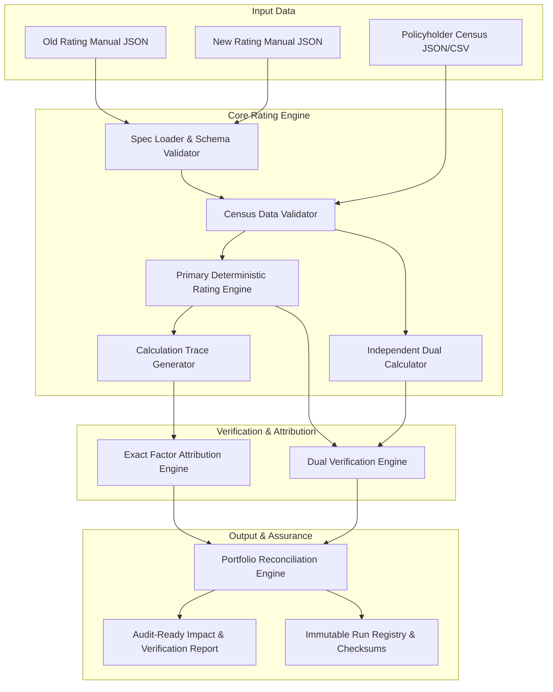

# Rate Change Assurance Workbench: Phase 1 Code Audit & Implementation Architecture

## 1. Executive Summary & Objective

The objective of the **Rate Change Assurance Workbench** is to provide an audit-grade environment for insurance pricing actuaries to:
1. Compare two rating manual versions (**Old vs. New**).
2. Validate policy census data against rating rules.
3. Compute deterministic policy premiums with a transparent, step-by-step calculation trace.
4. Execute dual independent verification (primary engine vs. independent secondary calculator).
5. Decompose premium differences ($\Delta P_i$) into exact factor attributions without residual leakage.
6. Reconcile aggregate portfolio impacts, segment dislocations, and premium disruption curves.
7. Generate audit-ready reports and immutable cryptographic run records.

Per the foundational engineering rule: **Correctness first, then verification, then interface, then commercial reporting.**

---

## 2. Phase 1 — Code Audit & Reusable Component Mapping

| Existing Module | Current Responsibility | Audit Finding | Workbench Reuse Action |
| :--- | :--- | :--- | :--- |
| `actuarial/data_gate.py` | 10 pre-flight quality rules on driver/vehicle variables | Clean, extensible rule engine using explicit validation failure classes. | **Reuse & Extend**: Adapt into `rate_engine/validator.py` to validate policyholder census against rating manual variable requirements and domain ranges. |
| `backend/services/reconciliation_service.py` | 5-step sequential arithmetic attribution for GLM states | Formulates step-by-step state evaluation ($P_0 \to P_5$) and verifies $\sum \Delta_k = \Delta P$. | **Adapt**: Evolve from statistical GLM states into **Rating Rule Factor Attribution** (Base Rate $\to$ Multiplicative Factors $\to$ Fees $\to$ Clamping/Rounding). |
| `backend/services/run_registry.py` | JSON run store with SHA-256 artifact checksums and $\le 10^{-6}$ replay | Excellent immutable audit ledger architecture with replay capability. | **Reuse directly**: Track input hashes, rating manual hashes, execution environment, and bit-exact reproducibility. |
| `backend/services/reporting_service.py` | Executive HTML dossier generator | Clean HTML template architecture. | **Adapt**: Re-target template from GLM validation metrics to **Rate Filing & Disruption Report** (disruption curves, segment tables, reconciliation proofs). |
| `actuarial/pricing.py` | Commercial loading formulas (tax, expense ratios) | Reliable expense and margin arithmetic. | **Reuse**: Retain commercial loading formulas as optional layer in rating manuals. |
| `actuarial/train_frequency.py`, `train_severity.py`, `shap_service.py`, `simulation_service.py` | Poisson/Gamma GLMs, LightGBM, SHAP values, Monte Carlo VaR/TVaR | Well-built statistical components, but out of scope for deterministic rating manual verification. | **Defer from MVP**: Isolate and keep dormant; focus MVP entirely on deterministic rating manual verification. |

---

## 3. Specification & Engine Design (Phases 2 & 3)

---

## 4. Phase 2: Supported Rating Manual Schema Contract

Each rating manual specification contains:
- `manual_id`: Unique identifier (e.g., `manual_auto_v1_old`).
- `version`: Semantic version string.
- `effective_date`: Date in ISO-8601 format.
- `line_of_business`: Target line (e.g., `Personal Auto`).
- `currency`: Currency ISO code (`USD`, `EUR`, `GBP`, `INR`).
- `base_rate`: Initial unadjusted policy rate.
- `factor_tables`: Key-value dictionaries mapping rating variable categories or ranges to multipliers.
- `additive_fees`: List or dictionary of fixed surcharges/fees.
- `min_premium` / `max_premium`: Clamping bounds.
- `rounding_rule`: Precision (decimal places) and rounding method (`ROUND_HALF_UP`).
- `calculation_order`: Explicit pipeline sequence ensuring reproducible execution.

---

## 5. First Implementation Task Specification (The 5-Policy Prover)

### Manual Specifications

#### Manual A (Old Rating Manual: `manual_v1_old.json`)
- Base Rate: **$400.00**
- Factor Table `territory`:
  - `Urban`: **1.20**
  - `Suburban`: **1.00**
  - `Rural`: **0.80**
- Additive Fee: `policy_fee` = **$25.00**
- Rounding: **2 decimal places, ROUND_HALF_UP**
- Formula: $P = \text{round}(\text{Base} \times \text{TerritoryFactor} + \text{Fee}, 2)$

#### Manual B (New Rating Manual: `manual_v2_new.json`)
- Base Rate: **$440.00** (+10.0% base rate update)
- Factor Table `territory`:
  - `Urban`: **1.30** (+8.33% factor increase)
  - `Suburban`: **1.00** (0.0% factor change)
  - `Rural`: **0.75** (-6.25% factor reduction)
- Additive Fee: `policy_fee` = **$30.00** (+$5.00 fee increase)
- Rounding: **2 decimal places, ROUND_HALF_UP**
- Formula: $P = \text{round}(\text{Base} \times \text{TerritoryFactor} + \text{Fee}, 2)$

---

### Hand-Calculated Policy Benchmarks

| Policy ID | Territory | Old Premium Calculation | Old Premium | New Premium Calculation | New Premium | Absolute Delta ($\Delta P$) | % Change |
| :--- | :--- | :--- | :--- | :--- | :--- | :--- | :--- |
| **POL-001** | Urban | $400 \times 1.20 + 25 = 480 + 25$ | **$505.00** | $440 \times 1.30 + 30 = 572 + 30$ | **$602.00** | **+$97.00** | **+19.21%** |
| **POL-002** | Suburban | $400 \times 1.00 + 25 = 400 + 25$ | **$425.00** | $440 \times 1.00 + 30 = 440 + 30$ | **$470.00** | **+$45.00** | **+10.59%** |
| **POL-003** | Rural | $400 \times 0.80 + 25 = 320 + 25$ | **$345.00** | $440 \times 0.75 + 30 = 330 + 30$ | **$360.00** | **+$15.00** | **+4.35%** |
| **POL-004** | Urban | $400 \times 1.20 + 25 = 480 + 25$ | **$505.00** | $440 \times 1.30 + 30 = 572 + 30$ | **$602.00** | **+$97.00** | **+19.21%** |
| **POL-005** | Rural | $400 \times 0.80 + 25 = 320 + 25$ | **$345.00** | $440 \times 0.75 + 30 = 330 + 30$ | **$360.00** | **+$15.00** | **+4.35%** |
| **TOTAL** | — | — | **$2,125.00** | — | **$2,394.00** | **+$269.00** | **+12.66%** |

### Exact Factor Attribution Proof (POL-001)
- **Step 0 (Old Baseline)**: $400.00 \times 1.20 + 25.00 = \$505.00$
- **Step 1 (Base Rate $400 \to 440$)**: $440.00 \times 1.20 + 25.00 = \$553.00 \implies \Delta_{\text{base}} = +\$48.00$
- **Step 2 (Territory Factor $1.20 \to 1.30$)**: $440.00 \times 1.30 + 25.00 = \$597.00 \implies \Delta_{\text{factor}} = +\$44.00$
- **Step 3 (Policy Fee $25 \to 30$)**: $440.00 \times 1.30 + 30.00 = \$602.00 \implies \Delta_{\text{fee}} = +\$5.00$
- **Sum of Attributions**: $48.00 + 44.00 + 5.00 = \mathbf{+\$97.00}$
- **Reconciliation Residual**: $\$97.00 - \$97.00 = \mathbf{\$0.00}$ (Bit-exact identity).
